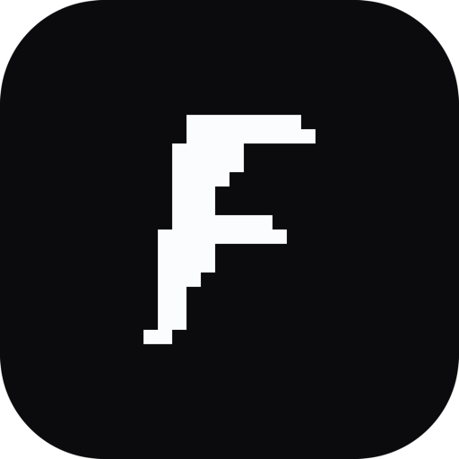

# Fettlr

A cross-platform desktop app for managing Claude Code's skills, subagents, plugins, marketplaces,
and MCP servers.

**→ [Download page](https://fettlr.space.fast/)**, always pointing at the latest
release.

**Built with Tauri. macOS 13 (Ventura) or later today, with Windows and Linux planned. Unsigned: no
Apple Developer Program, no notarisation.**

---

## For users

Claude Code keeps its skills, subagents, plugins, marketplaces, and MCP servers in config files and
git clones scattered across your home folder. Fettlr reads the lot, at user level and per project,
and hands you the buttons.

### What it does

- **Needs updating:** one list of everything with an update waiting. Update an item on its own or
  run **Update All**.
- **Skills:** every skill Claude Code can load, with the description from its `SKILL.md`.
  **Disable** parks the skill's folder in Fettlr's own store so Claude Code cannot load it, and
  **Enable** puts it back untouched. Deleting moves the folder to the Trash, never `rm -rf`. Skills
  that came from a git clone can be pulled up to date in place.
- **Subagents:** every custom subagent from your user directory, your projects, and your plugins,
  with its model, tools, and permission mode; disable one without deleting it, or send it to the
  Trash.
- **Plugins:** install from any marketplace you have added, then enable, disable, update, or
  uninstall. Each plugin lists the skills and MCP servers it carries, and where it is installed.
- **Marketplaces:** add one by repo or URL, refresh the listings, and see which are behind their
  remote.
- **MCP servers:** user, project, and local scope side by side, plus the servers plugins provide.
  Add or edit one through a form instead of hand-writing JSON. Disabling a user-scope server keeps
  its full definition so enabling restores it exactly; project-scope servers use Claude Code's own
  enable and disable lists.
- **Update tracking:** marketplaces behind their remote, plugins on an older version than their
  marketplace offers, git-backed skills behind their upstream, and MCP servers whose pinned npm or
  PyPI package has a newer release. Checks run when Fettlr opens and, if you want, on an interval.
- **Per project:** filter skills, subagents, plugins, and MCP servers by project scope, next to
  your user-level setup.
- **Find and jump:** every list filters as you type (Cmd+F), and Cmd+K jumps straight to any
  skill, subagent, plugin, marketplace, or MCP server by name.
- **Three languages:** English (US and UK) and French, following your system language setting.
- **Self-updating:** Fettlr checks GitHub Releases for new versions and installs them in place, no
  drag-and-drop.

### Screenshots

*Coming once the first release ships.*

### Install

The app is unsigned, deliberately: no Apple Developer Program, no signing. macOS therefore blocks
it on first launch. To allow it:

1. Open the downloaded DMG and drag **Fettlr** to your **Applications** folder.
2. Double-click **Fettlr**; when macOS warns it "can't verify the developer", click **Done** (*not*
   "Move to Trash"). Right-click the app and choose **Open** if your macOS version still offers that
   shortcut.
3. Open **System Settings → Privacy & Security**, scroll to the **Security** section, and click
   **Open Anyway** next to *"Fettlr" was blocked to protect your Mac*.
4. Authenticate and click **Open**.

macOS only asks once. After that it launches normally.

Using Claude Code? Point it at
[`bootstrap/fettlr-launcher/SKILL.md`](bootstrap/fettlr-launcher/SKILL.md) and it installs and
launches Fettlr for you, verifying the download against Fettlr's release key first.

### Using it

1. Launch the app. Fettlr looks for the `claude` binary itself; if it cannot find it, point it at
   one in **Settings**.
2. **Needs updating** lists everything with an update waiting. **Check for Updates** re-runs the
   checks, **Update All** works through the list.
3. **Skills**, **Plugins**, **Marketplaces**, and **MCP Servers** each list what you have, filtered
   by scope, with the details and the actions in the panel that opens when you select a row.
4. **Settings** holds the path to the `claude` binary, how often to check for updates, and Fettlr's
   own update checks.

Every change is followed by a full re-read of the real state, so what Fettlr shows is what is on
disk, not its own bookkeeping. Changes apply to new Claude Code sessions.

---

## For developers

### Requirements

- [Rust](https://rustup.rs/) (stable) and [Node.js](https://nodejs.org/) with
  [pnpm](https://pnpm.io/)
- macOS: Xcode Command Line Tools (`xcode-select --install`)
- Tauri's own platform prerequisites; see the
  [Tauri prerequisites guide](https://v2.tauri.app/start/prerequisites/)

### Build

```sh
pnpm install

# Core crate (no Tauri needed)
cargo test --workspace

# App: dev server with hot reload
pnpm tauri dev

# App: production bundle
pnpm tauri build
```

### Gates

```sh
cargo test --workspace
cargo clippy --workspace --all-targets -- -D warnings
cargo fmt --check
pnpm run gate   # typecheck, lint, contrast check, localisation sync
```

All must pass before a commit.

### App icon

```sh
swift scripts/make-icon.swift
pnpm --dir app tauri icon ../assets/icon-1024.png
```

The first command redraws `assets/icon-1024.png`, a 1024×1024 master, from
`assets/fettlr-glyph.svg` and the fill constant at the top of the script. Deterministic, so
re-running it changes nothing unless you change those constants. The second expands that master
into every platform's icon set in `app/src-tauri/icons/`.

### Localisation

Strings live in i18next JSON files under `app/src/locales/`. After adding or changing a
user-facing string:

```sh
./scripts/sync-localizations.py          # sync keys, mirror en → en-GB
./scripts/sync-localizations.py --check  # fails if anything is untranslated
```

### Architecture

```
fettlr/
├── crates/
│   └── fettlr-core/     Rust domain logic: CLI bridge, discovery, stores, updates, watcher.
│                          No Tauri dependency, fully tested independently.
├── app/
│   ├── src-tauri/         thin Tauri shell: typed IPC commands, events, the updater
│   └── src/                React + TypeScript frontend, view-only
├── packages/
│   └── design-system/     tokens, Tailwind theme, restyled shadcn components
├── site/                   Astro download site, imports the design system
├── scripts/                 icon generation, localisation sync/check
└── assets/                  source icon artwork
```

**Key invariants:**

- All domain logic lives in `fettlr-core`, independent of Tauri and fully tested; the app shell is
  a thin typed IPC layer, and the frontend is view-only.
- The core crate never resolves `~`; every path that depends on your machine arrives injected via a
  `Paths` struct, so tests can point the whole crate at a temporary directory. The exceptions are
  four documented platform constants: `/opt/homebrew/bin/claude` and `/usr/local/bin/claude`, the
  well-known places Claude Code installs itself; `/bin/zsh`, the login shell used to find it when
  neither is there; and `/usr/bin/git`. They hold until the portability milestone.
- Secrets (MCP environment variables and header values) never leave the Tauri shell unmasked and
  never appear in logs.
- Contrast is enforced mechanically with APCA: `packages/design-system/scripts/check-contrast.mjs`
  checks every declared foreground-on-background pair against its Lc level, in both light and dark,
  on every run, with a ceiling on hairlines so a rule can never reach text weight.

For the full agent and contributor guide (conventions, invariants, build and test workflow), see
[`AGENTS.md`](AGENTS.md).

## Licence

MIT. © 2026 Thomas Guillot.
